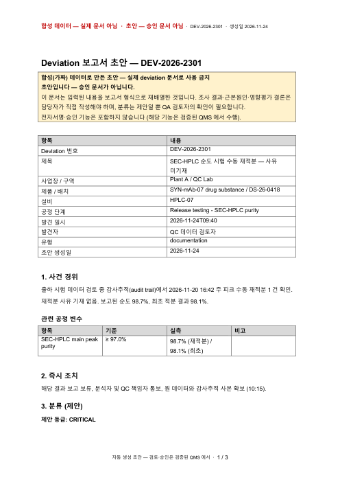
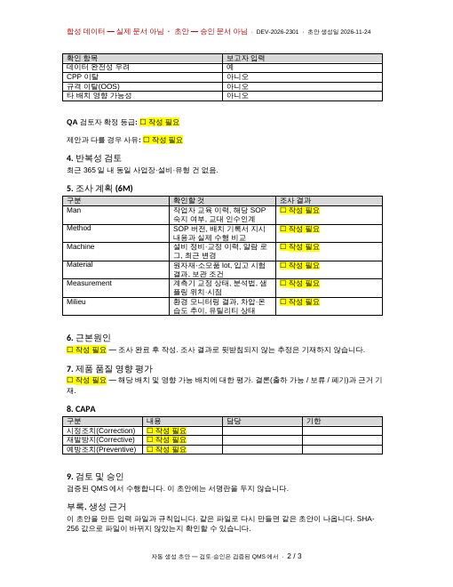

# gmp-deviation-draft

[](https://github.com/strawberryHunter/gmp-deviation-draft/actions/workflows/tests.yml)


**GMP deviation 보고서의 반복 작업만 덜어 주고, 판단은 절대 대신하지 않는 초안 도우미.**

```
양식 입력(YAML) → 검증 → 분류 제안 + 반복성 조회 + 조사 계획 → 초안(Markdown / Word) → 사람이 검토·승인(QMS)
```

> **English summary.** A local, offline drafting assistant for GMP deviation reports. It restructures the facts a QA
> author enters, proposes a classification from site-configurable rules *with its reasons*, lists prior similar
> deviations, and emits a Word draft — but deliberately leaves root cause, product-impact assessment, CAPA and the
> final classification blank (`☐ 작성 필요`) for people to write. In GxP documentation, plausible-sounding text that
> no investigation supports is the most dangerous output, so the design rule is "never fill in judgement".
> All data in this repository is synthetic.

> **모든 데이터는 합성(가짜) 데이터입니다.** 사업장·제품·배치·설비·deviation 사례 모두 지어낸 것입니다.

**처음 보는 분 → [10분 튜토리얼](docs/TUTORIAL.md)** — 입력 양식 → 초안 → 틀린 양식 거부 → 요약표 → SOP 바꾸기를 실제 명령과 실제 출력으로 따라 합니다.

## 왜 이렇게 만들었나 — 핵심 설계 판단

GxP 문서에서 가장 위험한 것은 **조사로 뒷받침되지 않은 그럴듯한 문장**입니다. 자동화는 시간을 줄이지만, 판단을 대신하면 감사에서 근거 없는 기록이 됩니다. 그래서 경계를 이렇게 그었습니다.

| 도구가 하는 것 | 도구가 하지 않는 것 (사람 몫) |
|---|---|
| 입력한 사실을 보고서 형식으로 재배열 | 근본원인·제품 영향 평가·CAPA 작성 |
| SOP 규칙에 따른 등급 **제안**과 근거 표시 | 등급 확정, 위험 점수 매기기 |
| 과거 같은 사업장·설비·유형 deviation **목록** | 과거 원인으로 이번 원인 추정 |
| 도구가 평가할 수 없는 SOP 조항을 `☐` 확인 항목으로 표시 | SOP에 없는 등급·기준 만들어 내기 |
| 누락·애매한 입력(`yes`, 빈칸)을 거부하고 이유 안내 | 빈칸을 "아니오"로 추정 |
| 입력 파일명·SHA-256·기준일·도구 버전을 초안에 기록 | 전자서명·승인 (검증된 QMS에서) |

이 경계는 문서가 아니라 **테스트로 강제**됩니다. 예: 판단 칸이 비어 있는지, 초안에 입력에 없는 수치가 들어가지 않는지, 패키지가 네트워크·LLM 라이브러리를 import하지 않는지.

## 결과물 미리보기 (설치 없이)

현실적인 합성 사례 4건을 도구에 넣어 만든 Word 초안을 PDF로 렌더링한 것입니다. 판단이 필요한 칸은 노란 `☐ 작성 필요`로 비어 있고, 모든 쪽 머리글에 "초안 — 승인 문서 아님"이 붙습니다.

<table>
<tr>
<td></td>
<td></td>
</tr>
<tr><td colspan="2" align="center">DEV-2026-2301 — 1쪽: 사실 정리·분류 제안과 근거 · 2쪽: 판단 칸은 모두 비워 둠</td></tr>
</table>

| 사례 | 상황 | 도구 제안 | 초안 |
|---|---|---|---|
| DEV-2026-2301 | SEC-HPLC 수동 재적분, 사유 미기재 | CRITICAL — 데이터 완전성 우려 | [PDF](sample_output/showcase/DEV-2026-2301_draft.pdf) · [MD](sample_output/showcase/DEV-2026-2301_draft.md) |
| DEV-2026-2302 | 원료 입고 시험 엔도톡신 OOS | MAJOR — 규격 이탈 | [PDF](sample_output/showcase/DEV-2026-2302_draft.pdf) · [MD](sample_output/showcase/DEV-2026-2302_draft.md) |
| DEV-2026-2303 | 무균 복장 자격 만료 작업자의 Grade B 작업 | CRITICAL — 무균 보증 영향 | [PDF](sample_output/showcase/DEV-2026-2303_draft.pdf) · [MD](sample_output/showcase/DEV-2026-2303_draft.md) |
| DEV-2026-2304 | 2-8°C 보관실 25분 온도 초과 | MAJOR — 다른 배치 영향 가능 | [PDF](sample_output/showcase/DEV-2026-2304_draft.pdf) · [MD](sample_output/showcase/DEV-2026-2304_draft.md) |

등급은 **제안**이고 확정은 QA 검토자가 합니다.

## 실제 SOP에 맞추기

분류 기준은 코드가 아니라 [`config/rules.yaml`](config/rules.yaml) 한 파일에 있어 QA가 직접 고칩니다.
공개된 실제 deviation SOP를 옮겨 본 예시가 있습니다.

- **Duke COMM-PAS-013** ([매핑 문서](docs/sop_mapping/Duke_COMM-PAS-013.md) → [rules](config/examples/rules_Duke_COMM-PAS-013.yaml)) — 이 SOP에는 Critical/Major/Minor가 **없습니다.** 그래서 도구는 SOP가 정의한 "Repeat Deviation(2년 내 재발)" 해당 여부만 제안하고, 사람이 매기는 위험 점수(Severity × Probability × Detectability)는 `☐` 확인 항목으로 남깁니다. SOP 원문은 저장소에 복사하지 않고 조항별 매핑만 기록했습니다.
- **합성 SOP** ([원문](data/synthetic/sop/SYN-QA-SOP-001.md) → [rules](config/examples/rules_SYN-QA-SOP-001.yaml)) — 모든 조항이 rules에 추적되는지 테스트로 확인합니다.

## 직접 재현해서 고친 결함

만들면서 "조용히 틀리는" 경우를 찾아 재현하고, 고친 뒤 그 테스트가 이전 코드에서 실패하는지 확인했습니다.

| 결함 | 영향 | 지금 |
|---|---|---|
| 입력 문장 속 `\|` `#` `*` `>` 등을 Markdown이 해석 | 파라미터 이름의 `\|` 때문에 표 열이 밀려 **실측 칸에 `Fail*` 대신 `Pass`** 표시, `#4 포트`가 제목으로, 작업자 진술이 경고 상자로 | 입력값을 이스케이프해 Word·GitHub 모두 입력 그대로 표시 |
| 위험 항목 미응답이 `False`로 처리 | 무균 영향 질문을 비워도 MINOR 제안 | 미응답·`yes`/`no`·`"true"` 거부 |
| 기본 이력이 합성 데이터 | 실제 양식에 가짜 반복 건 5건이 붙어 MAJOR 근거가 됨 | 실제 양식 + 합성 이력은 거부 |
| Excel "CSV UTF-8"의 BOM | 반복 건 표의 deviation 번호가 전부 빈칸 | BOM 처리, 이력 점검 명령 추가 |
| 이력에 이번 건 자신이 있음 | 자기 자신을 반복 건으로 셈 | 제외하고 초안에 표시 |
| 템플릿 주석이 값에 붙음 (`제목# [필수]…`) | 주석 문구가 초안에 그대로 들어감 | 거부 |
| 도구가 평가 못 하는 SOP 조항 | 초안에 흔적이 없어 검토자가 모름 | `manual_checks`로 `☐` 표시 |
| Word 2·3쪽에 초안 표시 없음 | 쪽만 떼면 완성 문서처럼 보임 | 모든 쪽 머리글 |
| 영문 Windows 콘솔 | 한국어 메시지에서 오류로 종료 | 한글 못 쓰는 콘솔만 UTF-8로 전환 |
| Windows `cmd`·PowerShell의 `*.yaml` | 셸이 펼치지 않아 오류로 종료 | 도구가 직접 펼침, 없는 파일은 거부로 처리 |

판단 과정은 [`DECISIONS.md`](DECISIONS.md)에 한 줄씩 남겼습니다 (무엇을 · 왜 · 대안 · 확인 필요 여부).

## 빠른 실행

```bash
pip install -r requirements.txt
python -m pytest -q
python -m devdraft.cli data/synthetic/showcase/*.yaml --docx --summary --today 2026-11-24 --out drafts
```

`drafts/`에 사례별 Markdown·Word 초안과 요약표(Markdown·Word)가 생깁니다. 단계별 설명은 [튜토리얼](docs/TUTORIAL.md). 직접 양식을 쓰려면 [`templates/intake_template.yaml`](templates/intake_template.yaml)을 복사해 채웁니다.
설치, 거부 메시지 대응, 초안 검토 방법, rules.yaml 전체 항목, 이력 파일 준비, 종료 코드는 [사용 가이드](docs/USAGE.md)에 있습니다.

## 검증

- 테스트 233개 — GitHub Actions에서 Ubuntu Python 3.10–3.13, Windows 3.12로 PR마다 실행
- 튜토리얼에 실린 명령 출력·입력 파일·초안 발췌가 실제와 같은지 테스트가 대조
- 같은 입력이면 바이트 단위로 같은 초안 (생성 근거의 SHA-256으로 대조 가능)
- 입력한 문장은 Markdown 기호가 섞여 있어도 Word·GitHub에서 입력 그대로 표시 (CommonMark+GFM 파서로도 확인)
- `sample_output/`이 현재 코드의 출력과 다르면 테스트 실패
- 외부 전송·LLM 호출 없음 — 패키지의 import 허용 목록을 테스트가 검사

## 데이터 취급

- 저장소의 데이터는 모두 합성입니다. 합성 초안에는 "합성 데이터 — 실제 문서 아님"이 모든 쪽에 표시됩니다.
- `drafts/`와 `*.docx`는 `.gitignore` — 실제 deviation 내용이 저장소에 들어가지 않도록.
- 실제 업무에 쓰려면 사내 환경에서 실행하고, 사내 절차에 따른 검토와 필요 시 소프트웨어 적격성 평가가 먼저 필요합니다.

## 구조

```
devdraft/
  intake.py     양식 로드 + 검증 (누락·미허용·애매한 값 거부)
  rules.py      rules.yaml 로드 + 검증 (오류면 실행 중단)
  classify.py   분류 제안, 반복성 조회, 6M 조사 계획
  history.py    이력 CSV 점검 (--check-history)
  draft.py      Markdown 초안 (판단 칸은 ☐ 작성 필요, 생성 근거 부록)
  docx_out.py   Word 변환 (모든 쪽 '초안' 머리글, 빈칸 노란 강조)
  summary.py    일괄 처리 요약표 (--summary)
  cli.py        실행 진입점
config/rules.yaml                 분류 규칙 (QA가 고치는 유일한 파일)
config/examples/                  SOP를 옮긴 예시 (Duke 공개 SOP, 합성 SOP)
templates/intake_template.yaml    빈 입력 양식
data/synthetic/                   합성 이력·양식·SOP (scripts/make_synthetic_data.py로 재생성)
sample_output/                    샘플 초안, showcase/ (PDF·이미지: scripts/make_showcase.py)
docs/TUTORIAL.md · docs/USAGE.md · docs/HANDOFF.md · DECISIONS.md
tests/
```
