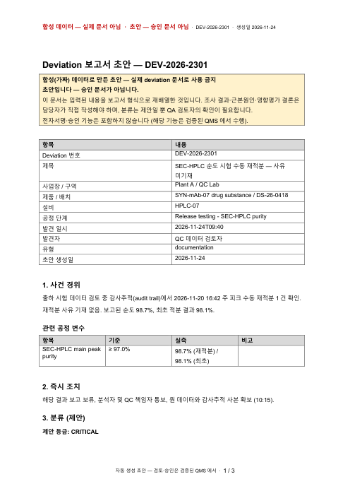
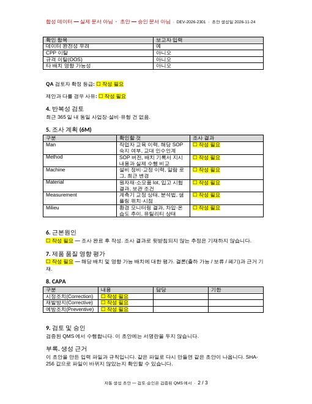
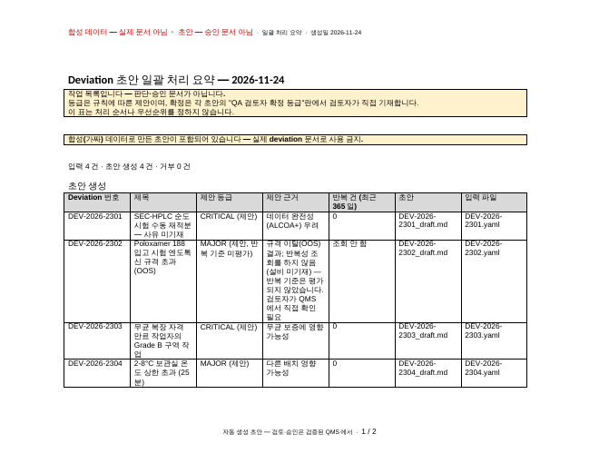

# 튜토리얼 — 10분 따라 하기

이 저장소의 합성 데이터로 **deviation 보고서 초안이 어떻게 만들어지는지** 처음부터 끝까지 따라 합니다.
각 단계에 실제 명령과 **실제 출력**을 그대로 실었습니다. 이 문서의 출력은 테스트(`test_tutorial_*`)가 다시 실행해 대조하므로, 도구가 바뀌면 문서도 같이 고쳐야 테스트가 통과합니다.

> 모든 데이터는 합성(가짜)입니다. 판단이 필요한 칸(근본원인·영향평가·CAPA·등급 확정)은 도구가 채우지 않습니다.

## 0. 준비

```bash
git clone https://github.com/strawberryHunter/gmp-deviation-draft.git
cd gmp-deviation-draft
python -m pip install -r requirements.txt
python -m pytest -q
```

Git이 없으면 GitHub에서 **Code → Download ZIP**으로 받아 압축을 풀고 그 폴더로 `cd`합니다. Python 설치와 `python` 명령이 안 될 때는 [사용 가이드 1장](USAGE.md#1-설치-최초-1회)을 보십시오. 모든 명령은 저장소 폴더 안에서 실행합니다.

Python 3.10 이상, Windows·macOS·Linux 모두 됩니다. 아래 명령의 `*.yaml`은 Windows `cmd`·PowerShell에서도 그대로 동작합니다.
Windows에서는 출력의 경로가 `drafts\DEV-…`처럼 `\`로 보입니다 (이 문서는 `/`로 적었습니다).

## 1. 입력 양식 보기

deviation 하나 = YAML 파일 하나입니다. 사람이 확인한 **사실만** 적습니다. 아래는 합성 사례 하나입니다 (HPLC 수동 재적분).

<!-- file: data/synthetic/showcase/DEV-2026-2301.yaml -->
```yaml
synthetic: true
id: DEV-2026-2301
title: SEC-HPLC 순도 시험 수동 재적분 — 사유 미기재
site: Plant A
area: QC Lab
product: SYN-mAb-07 drug substance
batch: DS-26-0418
equipment_id: HPLC-07
category: documentation
detected_at: 2026-11-24T09:40
detected_by: QC 데이터 검토자
process_step: Release testing - SEC-HPLC purity
description: 출하 시험 데이터 검토 중 감사추적(audit trail)에서 2026-11-20 16:42 주 피크 수동 재적분 1건 확인.
  재적분 사유 기재 없음. 보고된 순도 98.7%, 최초 적분 결과 98.1%.
immediate_actions: 해당 결과 보고 보류, 분석자 및 QC 책임자 통보, 원 데이터와 감사추적 사본 확보 (10:15).
parameters:
- name: SEC-HPLC main peak purity
  spec: ≥ 97.0%
  actual: 98.7% (재적분) / 98.1% (최초)
cpp_excursion: false
spec_oos: false
other_batches_possibly_affected: false
sterility_assurance_impacted: false
released_product_affected: false
data_integrity_concern: true
patient_safety_impact: false
regulatory_report_required: false
```

- 맨 아래 8개는 **위험 확인 질문**입니다. 반드시 `true` / `false`로 답합니다. 비우거나 `yes`/`no`로 쓰면 거부됩니다 (3단계).
- `synthetic: true`는 연습용 표시입니다. 초안 모든 쪽에 "합성 데이터"가 찍힙니다.
- 새 양식은 `python -m devdraft.cli --new DEV-2026-2301`로 만듭니다 (빈 템플릿 [`templates/intake_template.yaml`](../templates/intake_template.yaml)을 `drafts/`에 복사하고 번호를 채움).

## 2. 초안 만들기

<!-- verify exit=0 -->
```bash
python -m devdraft.cli data/synthetic/showcase/DEV-2026-2301.yaml --docx --today 2026-11-24 --out drafts
```
```text
OK  DEV-2026-2301.yaml -> drafts/DEV-2026-2301_draft.md, drafts/DEV-2026-2301_draft.docx
완료: 입력 1건 · 초안 1건 · 거부 0건 (저장 위치: drafts)
  → 초안의 '☐ 작성 필요' 칸과 등급 확정은 담당자가 작성합니다.
```

`drafts/`에 Markdown 초안과 Word 초안(`.docx`)이 생깁니다. `--today`는 결과를 똑같이 재현하려고 날짜를 고정한 것입니다 (빼면 오늘 날짜).

Word 초안은 이렇게 보입니다 ([PDF 전체](../sample_output/showcase/DEV-2026-2301_draft.pdf)):

<table>
<tr>
<td></td>
<td></td>
</tr>
</table>

### 초안에서 볼 곳

**분류 (제안)** — 등급과 그 근거를 같이 보여 줍니다. 확정은 검토자가 합니다.

<!-- excerpt: sample_output/showcase/DEV-2026-2301_draft.md -->
```markdown
## 3. 분류 (제안)

**제안 등급: CRITICAL**

근거:
- 데이터 완전성(ALCOA+) 우려

분류 기준 출처: ☐ **작성 필요** — 분류 기준 출처 미기재 (config/rules.yaml sop_reference). 사내 SOP와 대조 필요.
```

"분류 기준 출처"가 `작성 필요`인 것은 기본 rules.yaml이 아직 특정 SOP와 대조되지 않았기 때문입니다. 7단계에서 SOP를 바꾸면 여기에 SOP 번호가 찍힙니다.

**판단 칸** — 도구는 절대 채우지 않습니다.

<!-- excerpt: sample_output/showcase/DEV-2026-2301_draft.md -->
```markdown
## 6. 근본원인

☐ **작성 필요** — 조사 완료 후 작성. 조사 결과로 뒷받침되지 않는 추정은 기재하지 않습니다.
```

초안 맨 끝 **부록. 생성 근거**에는 입력 파일·규칙·이력 파일의 SHA-256과 기준일, 도구 버전이 남습니다. 같은 입력이면 같은 초안이 나옵니다.

## 3. 일부러 틀린 양식 넣어 보기

[`data/synthetic/tutorial/broken_form.yaml`](../data/synthetic/tutorial/broken_form.yaml)에는 흔한 실수 3가지가 있습니다: 발견자 빠짐, `spec_oos: no`, 양식에 없는 `root_cause`.

<!-- verify exit=1 -->
```bash
python -m devdraft.cli data/synthetic/tutorial/broken_form.yaml --today 2026-11-24 --out drafts
```
```text
ERR broken_form.yaml: 알 수 없는 항목: root_cause / 필수 항목 누락: detected_by / true/false가 아닌 값: spec_oos='no'
완료: 입력 1건 · 초안 0건 · 거부 1건 (저장 위치: drafts)
  → ERR 줄의 양식을 보완한 뒤 다시 실행하십시오. 거부된 양식은 초안을 만들지 않았습니다.
```

- 초안을 만들지 않고, 문제를 **한 번에 모두** 알려 줍니다.
- `no`를 "아니오"로 추정하지 않습니다. 습관적으로 쓴 `no`가 그대로 "아니오"가 되면, 위험 질문에 답하지 않은 것과 구분할 수 없기 때문입니다.
- 근본원인은 입력 양식에 적는 칸이 아닙니다. 조사 후 초안에 사람이 씁니다.
- 종료 코드 `1` = 거부된 양식이 있음.

## 4. 여러 건 한 번에 + 요약표

<!-- verify exit=0 -->
```bash
python -m devdraft.cli data/synthetic/showcase/*.yaml --docx --summary --today 2026-11-24 --out drafts
```
```text
OK  DEV-2026-2301.yaml -> drafts/DEV-2026-2301_draft.md, drafts/DEV-2026-2301_draft.docx
OK  DEV-2026-2302.yaml -> drafts/DEV-2026-2302_draft.md, drafts/DEV-2026-2302_draft.docx
OK  DEV-2026-2303.yaml -> drafts/DEV-2026-2303_draft.md, drafts/DEV-2026-2303_draft.docx
OK  DEV-2026-2304.yaml -> drafts/DEV-2026-2304_draft.md, drafts/DEV-2026-2304_draft.docx
SUM drafts/_summary_2026-11-24.md, drafts/_summary_2026-11-24.docx
완료: 입력 4건 · 초안 4건 · 거부 0건 (저장 위치: drafts)
  → 초안의 '☐ 작성 필요' 칸과 등급 확정은 담당자가 작성합니다.
```

요약표(`_summary_2026-11-24.md`, `--docx`면 가로 방향 Word도, `--xlsx`를 더하면 Excel도)는 작업 목록입니다. 등급은 모두 "(제안)"이고, 확정란·우선순위·과거 근본원인은 넣지 않습니다.



## 5. 실제 양식인데 이력을 안 주면

기본 이력 파일(`data/synthetic/history.csv`)은 합성입니다. `synthetic: true`가 없는 양식(= 실제 양식)을 그대로 돌리면, 가짜 반복 건이 실제 초안에 붙지 않도록 거부합니다.

<!-- verify exit=1 -->
```bash
python -m devdraft.cli data/synthetic/tutorial/no_synthetic_flag.yaml --today 2026-11-24 --out drafts
```
```text
ERR no_synthetic_flag.yaml: 반복성 조회 이력이 합성(가짜) 데이터입니다 — 실제 양식에 가짜 반복 건이 붙습니다. --history 로 실제 이력 CSV를 지정하십시오. (연습용 양식이면 양식에 synthetic: true)
완료: 입력 1건 · 초안 0건 · 거부 1건 (저장 위치: drafts)
  → ERR 줄의 양식을 보완한 뒤 다시 실행하십시오. 거부된 양식은 초안을 만들지 않았습니다.
```

실제로는 QMS에서 내보낸 이력 CSV를 `--history`로 줍니다.

## 6. 이력 파일 점검

이력 CSV를 처음 쓰거나 새로 내보낼 때마다 먼저 점검합니다. 초안은 만들지 않습니다.

<!-- verify exit=0 -->
```bash
python -m devdraft.cli --check-history --history data/synthetic/history.csv --today 2026-11-24
```
```text
이력 점검: data/synthetic/history.csv
행 51개 · 오류 0건 · 경고 0건
결과: 사용 가능
```

날짜 형식 오류·중복 번호·필수 열 누락은 오류(초안 생성 중단), 미래 날짜·빈 설비 ID 등은 경고입니다. Excel에서는 "CSV UTF-8"로 저장하는 것을 권장합니다 (한국어 Excel 기본 "CSV"도 경고와 함께 읽습니다).

## 7. SOP를 바꿔 보기 — 공개 SOP(Duke COMM-PAS-013)

분류 기준은 코드가 아니라 rules 파일에 있습니다. 공개된 실제 deviation SOP를 옮긴 규칙으로 바꿔 봅니다. 이 SOP에는 Critical/Major/Minor가 **없고**, "2년 안에 다시 일어난 deviation(Repeat Deviation)"과 사람이 매기는 위험 점수로 관리합니다.

<!-- verify exit=0 -->
```bash
python -m devdraft.cli data/synthetic/intake/DEV-2026-2202.yaml --rules config/examples/rules_Duke_COMM-PAS-013.yaml --today 2026-11-24 --out drafts/duke
```
```text
OK  DEV-2026-2202.yaml -> drafts/duke/DEV-2026-2202_draft.md
완료: 입력 1건 · 초안 1건 · 거부 0건 (저장 위치: drafts/duke)
  → 초안의 '☐ 작성 필요' 칸과 등급 확정은 담당자가 작성합니다.
```

<!-- excerpt: sample_output/sop_examples/duke/DEV-2026-2202_draft.md -->
```markdown
**제안 등급: Repeat Deviation (SOP 4.26)**

근거:
- 최근 2년 내 같은 사업장·설비·유형 deviation 재발 (SOP 4.26) — 유사 건 1건

**보고자가 "예"로 답했지만 이 규칙의 분류 기준이 아닌 항목: 타 배치 영향 가능성, 무균 보증 영향** — 제안 등급에 반영되지 않았습니다. 도구는 기준을 만들지 않습니다.

- ☐ **작성 필요** SOP에 따라 이 답변이 등급에 영향을 주는지 확인

분류 기준 출처: Duke COMM-PAS-013 Rev 01 (eff. 2025-07-01) — 공개 SOP 기반 예시, Duke와 무관

**도구가 판단하지 않은 SOP 기준 — 검토자가 직접 확인** (해당하면 위 제안 등급과 다를 수 있음):

- ☐ SOP 3.4: 발견 후 3영업일 안에 deviation이 개시되었는가 (발견 일시와 QMS 개시일 대조)
- ☐ SOP 8.4.2: Severity·Probability·Detectability 각 1–5점과 근거를 COMM-PAS-014 기준으로 기재하고, 세 점수를 곱한 Combined Risk Score 기재 — 도구는 점수를 매기지 않음
```

- 같은 양식이 기본 규칙에서는 CRITICAL, 이 SOP에서는 "Repeat Deviation"으로 제안됩니다. **SOP에 없는 등급을 도구가 만들지 않습니다.**
- 도구가 평가할 수 없는 조항(위험 점수 등)은 `☐` 확인 항목으로 남습니다.
- 보고자가 "예"로 답했지만 이 SOP의 기준이 아닌 항목(여기서는 무균 보증 영향 등)은 **반영되지 않았다고 명시**하고 `☐` 확인 항목으로 남깁니다. 도구가 기준을 만들어 내지도, 조용히 버리지도 않습니다.
- 조항별 매핑: [`docs/sop_mapping/Duke_COMM-PAS-013.md`](sop_mapping/Duke_COMM-PAS-013.md) · 전체 결과: [`sample_output/sop_examples/duke/`](../sample_output/sop_examples/duke/)

## 8. 다음

| 하고 싶은 것 | 볼 곳 |
|---|---|
| 내 양식 작성 | [`templates/intake_template.yaml`](../templates/intake_template.yaml) |
| 거부 메시지별 대응, 초안 검토 순서 | [사용 가이드 2–3장](USAGE.md) |
| 우리 SOP로 rules.yaml 바꾸기 | [사용 가이드 5장](USAGE.md) |
| 설계 판단과 이유 | [`DECISIONS.md`](../DECISIONS.md) |
