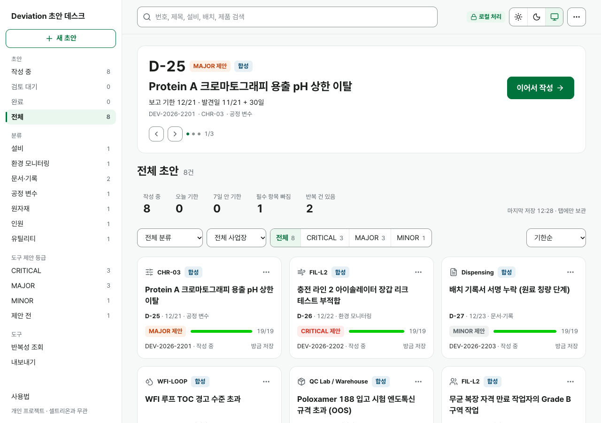
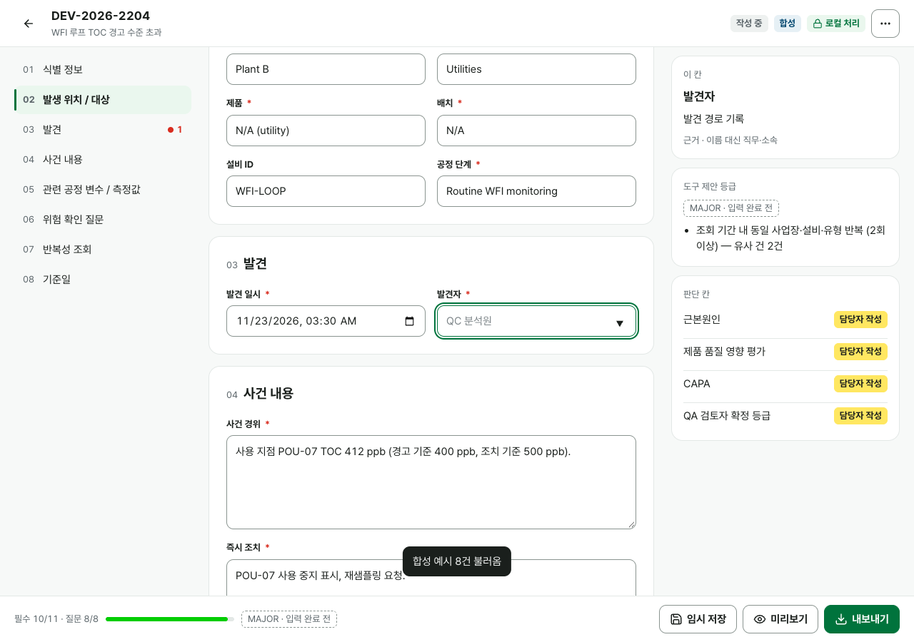

# web/ — Deviation 초안 데스크 (브라우저 화면)

CLI `devdraft`와 같은 판정 규칙으로, GMP deviation 보고서 초안을 여러 건 관리하는 브라우저 화면입니다.
빌드 결과는 HTML 한 파일과 글꼴·Word 변환 모듈·라이선스 파일입니다. 서버가 없습니다.

| | |
|---|---|
|  |  |

## 지키는 것 (CLI와 같음)

- 근본원인, 제품 품질 영향 평가, CAPA, QA 확정 등급은 항상 빈칸. 화면은 사실 정리, 등급 **제안**과 근거, 반복 건 목록까지만.
- 필수 항목이나 위험 질문이 빠진 초안은 만들지 않고, 등급 제안도 내지 않음 (CLI가 거부하는 양식과 같음).
- 외부 요청 0. 글꼴(Pretendard), 아이콘(Lucide), Word 변환(docx)은 페이지와 함께 묶음. 테스트가 요청 수를 셈.
- 입력 내용은 기본으로 탭에만 보관. 브라우저 저장은 사용자가 켤 때만.
- 합성 양식 8건의 등급·근거·반복 건, YAML 46개 사례의 읽기 결과가 CLI와 같음.

## 화면이 줄이는 일

| 업무 | 화면에서 |
|---|---|
| 처음부터 써서 Word 받기 | 클릭 3번 + 입력 (Tab만으로 끝까지) |
| 빠진 항목 찾기 | 카드에 이름이 보임, 열면 커서가 그 칸에 |
| 등급 제안과 근거 | 카드·사이드바에 바로, 근거는 작성 화면 오른쪽 |
| 같은 설비의 과거 건 | 이력 CSV를 한 번 고르면 모든 초안에 적용 |
| 보고 기한 | 발견 일시를 넣으면 D-day (발견일 + N일, N은 설정값) |
| 비슷한 건 새로 쓰기 | 복제 2클릭, 위치·설비·발견자 자동완성 |
| CLI 양식(.yaml) | 여러 파일을 한 번에 가져오기. 초안을 CLI 양식으로 내보내기 (복사, `번호.yaml.txt` 저장 — 덜 쓴 초안도 가능) |
| 측정값 여러 행 | Excel 범위 붙여넣기 한 번 |

## 구조

```
src/engine.js    규칙, 검증, 등급 제안, 반복성 조회, 초안 문서 모델, YAML 읽기, 기한·필터·내보내기 계산 (DOM 없음)
src/app.js       화면 (사이드바, 목록, 작성, 미리보기, 반복성 조회, 내보내기, 사용법)
src/style.css    디자인 토큰과 스타일
src/sample.js    합성 양식 8건 + 합성 이력 + 템플릿 안내 문구 (생성 파일)
assets/icons/    사용하는 Lucide 아이콘
tools/           build, 실제 입력 테스트(e2e), 화면 검사(shots), 화면 문구 목록(strings), CLI 기준값 생성(make_fixtures.py)
tests/           엔진 테스트 + CLI에서 뽑은 기준값(fixtures/: 양식, CLI 결과, YAML 읽기, rules.yaml과 그 해시)
```

판정 로직은 `src/engine.js`에만 둡니다. `app.js`는 등급을 정하지 않습니다.

## 실행

```bash
cd web
npm ci                     # playwright-core (테스트 전용, 설치된 Chrome을 headless로 사용)
npm run check              # 빌드 → 엔진 테스트 → 실제 입력 테스트 → 화면 검사
```

- `node tools/build.mjs` → `dist/index.html` (게시용), `dist/local.html` (브라우저에서 바로 열어 보기)
- `python web/tools/make_fixtures.py` (저장소 루트에서) → CLI 결과로 기준값을 다시 만듦. `--check`는 최신인지 검사만 (pytest와 CI가 실행)
- `node tools/strings.mjs` → [`docs/ui-strings.md`](docs/ui-strings.md) (화면 문구 전체. 설명체가 남았는지 검사)
- Chrome 위치가 다르면 `CHROME_PATH` 환경 변수로 지정
- 엔진 테스트 2개는 화면이 내보낸 양식을 CLI로 직접 돌려 봄. 저장소의 `.venv`를 쓰고, 없으면 PATH의 `python3`(Windows는 `python`), `PYTHON` 환경 변수로 지정 가능

파일 저장(Word·Markdown·CSV)은 게시된 화면(claude.ai 아티팩트)의 저장 기능을 씁니다. 로컬 파일로 열면 복사만 됩니다.

## 디자인 규칙

- 글자: Pretendard 400/700, 크기 13/15/17/19/24/32px만 (화면 검사가 확인)
- 색: 초록은 브랜드·행동에만. 등급은 빨강(CRITICAL)·주황(MAJOR)·회색(MINOR)이고 항상 글자와 함께. 예/아니오 선택은 검정
- 문구: 이름표·숫자·버튼 위주. 문장은 빈 상태와 오류에만 한 줄. 예외는 CLI와 글자까지 같아야 하는 등급 근거 문장
- 등급순 정렬 없음 (도구가 우선순위를 정하지 않음)

판단 기록은 저장소의 [`DECISIONS.md`](../DECISIONS.md) (2026-11-26, "웹" 항목), 버전 기록은 [`CHANGELOG.md`](CHANGELOG.md).

모든 예시 데이터는 합성입니다. 출력물은 승인 문서가 아니며, 승인은 검증된 QMS에서 합니다. 개인 프로젝트이며 특정 회사와 무관합니다.
